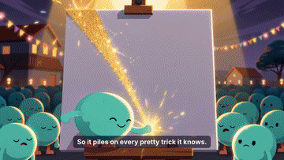
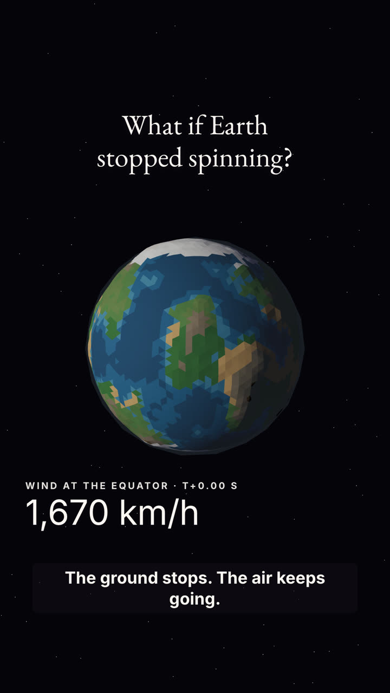
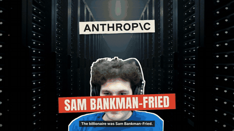
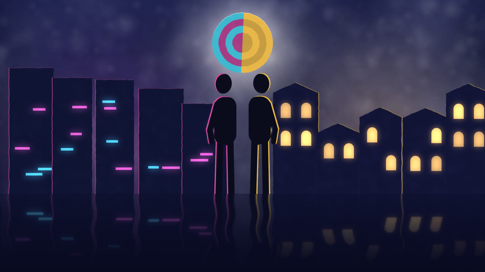
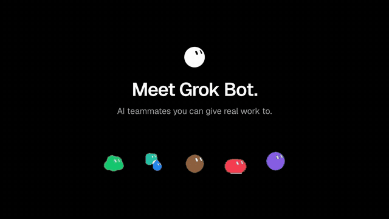
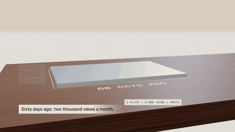

<div align="center">

# video-skills

**English** | [简体中文](README.zh-CN.md) | [日本語](README.ja.md) | [한국어](README.ko.md) | [Español](README.es.md) | [Deutsch](README.de.md) | [Français](README.fr.md) | [Português](README.pt.md)

**Remake a video with good taste in minutes.**

</div>

```bash
npx skills add sonnyproto/video-skills                       # the whole library (the agent picks an entry)
npx skills add sonnyproto/video-skills/categories/launch/broll-wheel   # just one entry
```

Then tell your agent:

```text
Remake broll-wheel for https://your-product.com
```

No other setup: the agent installs anything missing.

## Why this exists

Video skills today come in two shapes. Some are closed bundles: one style per purchase, fast, but you cannot see inside
or mix them. Others are deep open toolkits, each with its own format, so nothing lines up across them.

video-skills is the flat version of the first, done in the open:

- **One entry = one look and its sample, grouped by category.** Film entries come with the `result.mp4` they produced,
  look entries with three stills, so you choose with your eyes.
- **Reproducible.** Every entry ships a complete project that renders its film unchanged, plus the source IDs for stock footage and the prompts for any generated media. No API keys needed.
- **Same format everywhere.** Every entry has the same files and the same `taste.json` card, so you can compare entries,
  and agents can combine them ([spec/ENTRY.md](categories/spec/ENTRY.md)).
- **Product in one file.** Swapping in your product means editing `film.json` and the assets, never the generator.

## Library

<!-- CATALOG -->
| Preview | Entry | Category · method | Sample | Events / 10 s |
|---|---|---|---|---|
|  | [**cut-paper-stop-motion**](categories/explainer/cut-paper-stop-motion/) Cut-paper stop-motion | explainer · look only | stills |  |
|  | [**flat-cartoon**](categories/explainer/flat-cartoon/) Flat cartoon | explainer · generated-cartoon-shots | 24.1 s 16:9 | 9.1 |
|  | [**lowpoly-sim**](categories/explainer/lowpoly-sim/) Low-poly simulation | explainer · look only | stills | 9.0 |
|  | [**paper-collage**](categories/explainer/paper-collage/) Paper collage | explainer · narrated-paper-collage | 43.8 s 16:9 + 9:16 | 9.8 |
|  | [**paper-lightbox**](categories/explainer/paper-lightbox/) Paper lightbox | explainer · look only | stills |  |
|  | [**broll-wheel**](categories/launch/broll-wheel/) B-roll wheel launch | launch · broll-under-type | 90 s 16:9 | 8.7 |
|  | [**feature-roster**](categories/launch/feature-roster/) Feature roster | launch · rebuilt-ui-roster | 26.7 s 16:9 + 9:16 | 3.0 |
|  | [**metric-sculpture**](categories/launch/metric-sculpture/) Metric sculpture | launch · screencast-to-data-sculpture | 21.6 s 16:9 | 6.9 |
<!-- /CATALOG -->

## How an entry is built

A film entry:

```
categories/<category>/<id>/
├── SKILL.md       load this and make the film
├── taste.json     the card: requirements, seven layers, specs, metrics, what it needs, what it fits
├── references/    floor.md (shared rules), sourcing.md (launch, explainer: real material), RECIPE.md (shot by shot), SWAP.md (your product in), REFERENCE.md
├── scripts/       setup.sh (installs what is missing) and the measuring scripts
├── result/        result.mp4, poster, contact sheet, preview, metrics.json
└── project/       a renderable project: film.json, tools/, assets/
```

A look entry is `SKILL.md`, `style.json` (palette, type, texture, light, consistency, motion, pace), `STYLE.md` (how each
element is made) and `stills/` ([spec/STYLE.md](categories/spec/STYLE.md)). A film entry can carry a look too.

Every entry is placed on the same seven layers:

| Layer | Question |
|---|---|
| floor | What is never up for negotiation? (real product only, labelled samples, the brand) |
| category | What kind of film? (launch, explainer, tutorial, data story, social cut, sting) |
| method | How is the picture made, and how does the spine run? (b-roll under type, one shape never cut, beat montage, 3D UI...) |
| moves | Which concrete moves fill it? (wheel divider, marker sweep, anchor montage, pill morph...) |
| craft | What makes it look expensive? (hook in 3 s, burst near 35 %, hits on landings, -14 LUFS) |
| style | What does it look like? (grade, type, palette roles) |
| tool | What renders it? (HyperFrames, Remotion...) |

Different layers never conflict. On the same layer: floor > category > method > moves > craft > style.

Each entry is self-contained: our shared files (the floor rules, the measuring scripts) are copied into it, external tools
(HyperFrames, ffmpeg) are declared in `taste.json` `requires`, and taste is never shared. See [spec/ENTRY.md](categories/spec/ENTRY.md).

## Tools

| | |
|---|---|
| `categories/tools/floor.md` | the shared floor rules (copied into every entry's `references/`) |
| `categories/launch/sourcing.md` | how launch films collect the product's real screens, logo and copy (copied into every launch entry's `references/`) |
| `categories/tools/validate.py` | checks every entry against the format, and that its copies of the shared files match `categories/tools/` |
| `categories/tools/catalog.py` | rebuilds `categories/catalog.json` and the table above |
| `categories/tools/analyze.py <video> <out>` | cuts, shots, contact sheet, LUFS, true peak, BPM, cuts on the beat |
| `categories/tools/events.py <video> <out>` | visual change events per 10 s and still share |

## Three shelves

| Folder | What | Licence |
|---|---|---|
| [categories/](categories/) | the library above: one folder per category, one entry per film or look, each with its sample | MIT; result films and stills CC BY 4.0 |
| [moves/](moves/) | single shots (a crash zoom, a price slam, a logo lockup), one folder per move, found by tags | Apache-2.0 |
| [workflows/](workflows/) | how to make a film step by step, with a pass mark per step (voice then music, scene from references, style from reference, porting) | MIT |

## Requirements

Node 20+, ffmpeg, Python 3. Entries say what else they need (a renderer version, a video model for b-roll, a music model).

## Contributing

New entries are welcome; see [CONTRIBUTING.md](CONTRIBUTING.md). The bar: the project renders its result unchanged,
the product lives in `film.json`, the result is measured, and nothing from the reference is redistributed.

## Standing on

Ideas and rules borrowed, with thanks, from [HyperFrames](https://hyperframes.heygen.com),
[huashu-motion](https://github.com/alchaincyf/huashu-motion) (rhythm and director notes),
[video-shotcraft](https://github.com/Vincentwei1021/video-shotcraft) (recipe cards and the swap guide) and
[product-launch-motion](https://github.com/AbubakrChan/product-launch-motion) (craft details).

## Licence

The broll-wheel example is an unofficial spec film for Muse, Meta's personal AI agent. It is not affiliated with,
endorsed or sponsored by Meta; Muse and its assets are Meta's and are not in this repo.

Code: MIT, except `moves/`, which is Apache-2.0 (derived from video-shotcraft; see `moves/NOTICE`). Result films and generated media: CC BY 4.0. Example product assets belong to their owners; each entry's
`taste.json` says what may be reused.
