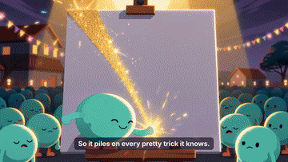
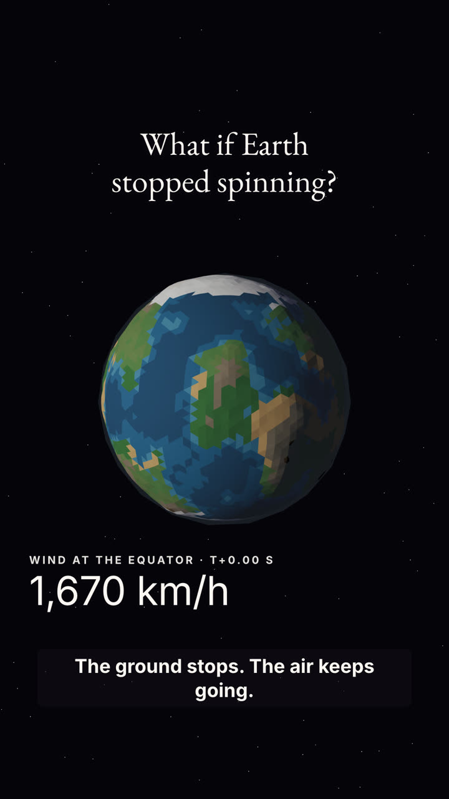
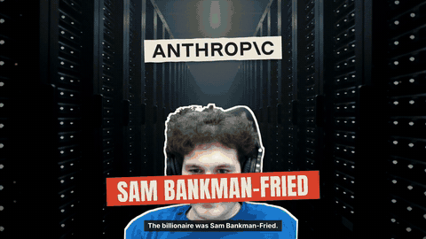
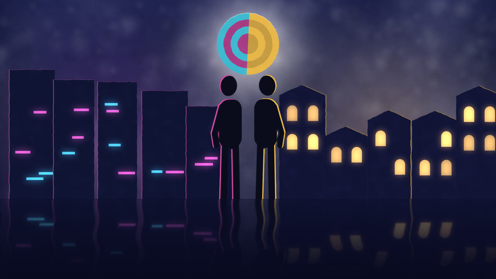
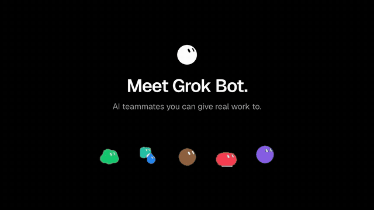
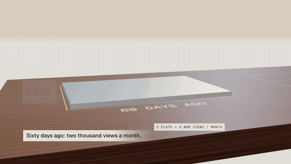

<div align="center">

# video-skills

[English](README.md) | [简体中文](README.zh-CN.md) | [日本語](README.ja.md) | [한국어](README.ko.md) | [Español](README.es.md) | [Deutsch](README.de.md) | [Français](README.fr.md) | **Português**

**Refaça um vídeo com bom gosto em minutos.**

</div>

```bash
npx skills add sonnyproto/video-skills                       # a biblioteca inteira (o agente escolhe a entrada)
npx skills add sonnyproto/video-skills/categories/launch/broll-wheel   # só este vídeo
```

Depois diga ao seu agente:

```text
Refaça o broll-wheel para https://your-product.com
```

Nada mais para configurar: o agente instala o que faltar.

## Por que isto existe

Hoje as skills de vídeo vêm em dois formatos. Uns são pacotes fechados: um estilo por compra, rápidos, mas não dá para ver
por dentro nem combiná-los. Outros são kits abertos e profundos, cada um com seu próprio formato, então nada se encaixa entre eles.

video-skills é a versão plana do primeiro, feita em aberto:

- **Uma entrada = um vídeo.** Cada uma vem com o `result.mp4` que produziu, então você escolhe com os olhos.
- **Reproduzível.** Cada entrada traz um projeto completo que renderiza seu vídeo sem alterações, além dos IDs de origem das imagens de banco e dos prompts de qualquer mídia gerada. Nenhuma chave de API é necessária.
- **O mesmo formato em todo lugar.** Todas as entradas têm os mesmos arquivos e o mesmo cartão `taste.json`, então você pode compará-las
  e os agentes podem combiná-las ([spec/ENTRY.md](categories/spec/ENTRY.md)).
- **O produto num só arquivo.** Para colocar o seu produto, basta editar o `film.json` e os assets, nunca o gerador.

## Biblioteca

<!-- CATALOG -->
| Preview | Entry | Category · method | Sample | Events / 10 s |
|---|---|---|---|---|
|  | [**cut-paper-stop-motion**](categories/explainer/cut-paper-stop-motion/) Cut-paper stop-motion | explainer · look only | stills |  |
|  | [**flat-cartoon**](categories/explainer/flat-cartoon/) Flat cartoon | explainer · code-rig-over-generated-plates | 10.0 s 16:9 | 2.0 |
|  | [**lowpoly-sim**](categories/explainer/lowpoly-sim/) Low-poly simulation | explainer · look only | stills | 9.0 |
|  | [**paper-collage**](categories/explainer/paper-collage/) Paper collage | explainer · narrated-paper-collage | 43.8 s 16:9 + 9:16 | 9.8 |
|  | [**paper-lightbox**](categories/explainer/paper-lightbox/) Paper lightbox | explainer · look only | stills |  |
|  | [**broll-wheel**](categories/launch/broll-wheel/) B-roll wheel launch | launch · broll-under-type | 90 s 16:9 | 8.7 |
|  | [**feature-roster**](categories/launch/feature-roster/) Feature roster | launch · rebuilt-ui-roster | 26.7 s 16:9 + 9:16 | 3.0 |
|  | [**metric-sculpture**](categories/launch/metric-sculpture/) Metric sculpture | launch · screencast-to-data-sculpture | 21.6 s 16:9 | 6.9 |
<!-- /CATALOG -->

## Como é uma entrada

```
<category>/<id>/
├── SKILL.md       carregue e faça o vídeo
├── taste.json     o cartão: requisitos, sete camadas, especificações, métricas, do que precisa, para que serve
├── references/    floor.md (regras comuns), sourcing.md (launch, explainer: material real), RECIPE.md (plano a plano), SWAP.md (seu produto), REFERENCE.md
├── scripts/       setup.sh (instala o que falta) e os scripts de medição
├── result/        result.mp4, pôster, folha de contato, prévia, metrics.json
└── project/       um projeto renderizável: film.json, tools/, assets/
```

Toda entrada é posicionada nas mesmas sete camadas:

| Camada | Pergunta |
|---|---|
| floor | O que nunca se negocia? (só o produto real, exemplos sinalizados, a marca) |
| category | Que tipo de vídeo? (lançamento, explicativo, tutorial, história com dados, corte para redes, vinheta) |
| method | Como a imagem é feita e como a espinha dorsal avança? (b-roll sob texto, uma forma nunca cortada, montagem no ritmo, UI em 3D...) |
| moves | Que recursos concretos a preenchem? (roda entre capítulos, traço de marca-texto, montagem de âncoras, morph de pílula...) |
| craft | O que faz parecer caro? (gancho em 3 s, explosão perto de 35 %, impactos nas aterrissagens, -14 LUFS) |
| style | Como ele parece? (correção de cor, tipografia, papéis da paleta) |
| tool | Com o que é renderizado? (HyperFrames, Remotion...) |

Camadas diferentes nunca entram em conflito. Na mesma camada: floor > category > method > moves > craft > style.

Cada entrada é autossuficiente: nossos arquivos comuns (as regras do floor, os scripts de medição) são copiados para dentro dela, as ferramentas externas
(HyperFrames, ffmpeg) são declaradas em `requires` do `taste.json`, e o gosto nunca é compartilhado. Veja [spec/ENTRY.md](categories/spec/ENTRY.md).

## Ferramentas

| | |
|---|---|
| `categories/tools/floor.md` | as regras comuns do floor (copiadas em `references/` de cada entrada) |
| `categories/launch/sourcing.md` | como os filmes de launch reúnem as telas, o logo e os textos reais do produto (copiado em `references/` de cada entrada de launch) |
| `categories/tools/validate.py` | confere cada entrada contra o formato e se as cópias dos arquivos comuns batem com `categories/tools/` |
| `categories/tools/catalog.py` | refaz o `categories/catalog.json` e a tabela acima |
| `categories/tools/analyze.py <video> <out>` | cortes, planos, folha de contato, LUFS, pico real, BPM, cortes na batida |
| `categories/tools/events.py <video> <out>` | eventos de mudança visual a cada 10 s e proporção de imagem parada |

## Requisitos

Node 20+, ffmpeg, Python 3. Cada entrada diz do que mais precisa (uma versão do renderizador, um modelo de vídeo para o b-roll, um modelo de música).

## Contribuir

Novas entradas são bem-vindas; veja [CONTRIBUTING.md](CONTRIBUTING.md). O critério: o projeto renderiza seu resultado sem alterações,
o produto fica no `film.json`, o resultado é medido e nada da referência é redistribuído.

## Agradecimentos

Ideias e regras emprestadas, com gratidão, de [HyperFrames](https://hyperframes.heygen.com),
[huashu-motion](https://github.com/alchaincyf/huashu-motion) (ritmo e notas de direção),
[video-shotcraft](https://github.com/Vincentwei1021/video-shotcraft) (cartões de receita e o guia de troca) e
[product-launch-motion](https://github.com/AbubakrChan/product-launch-motion) (detalhes de ofício).

## Licença

O exemplo broll-wheel é um vídeo especulativo não oficial para o Muse, o agente pessoal de IA da Meta. Não é afiliado à Meta
nem endossado ou patrocinado por ela; o Muse e seus assets pertencem à Meta e não estão neste repositório.

Código: MIT. Vídeos resultantes e mídia gerada: CC BY 4.0. Os assets dos produtos de exemplo pertencem aos seus donos; o
`taste.json` de cada entrada diz o que pode ser reutilizado.
