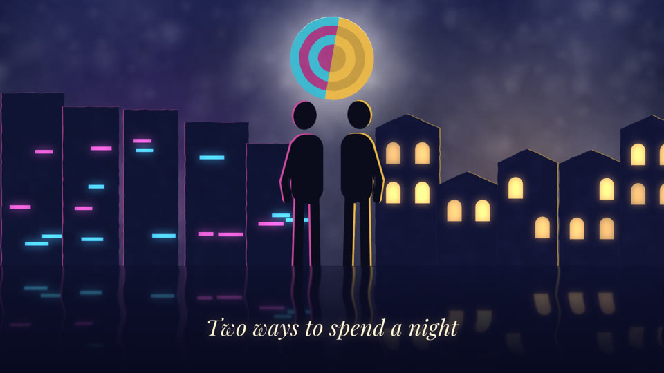

# moves

**Single shots for HyperFrames films: one folder per move, each with its preview, its code and its tags.**

A move is one beat of a film: a crash zoom onto a card, a price that slams in, a word filled on the downbeat, a logo
lockup. Whole films and looks are in [categories/](../categories/), how to make them in [workflows/](../workflows/). This folder holds the parts.

## Layout

```
<name>/
├── <name>.html     the HyperFrames composition (copy, colours and duration are variables)
├── move.json       name, tags, duration, what to swap, source and licence (MOVE.md)
├── MOVE.md         intent, parameters, pitfalls, when not to use it
├── poster.jpg      one frame
└── preview.gif     ~3 s, for the catalogue (the full mp4 is a release asset, not in git)
catalog.json        one line per move, rebuilt from every move.json
```

The list is flat. Moves are found by their tags, not by folders: `role` (hook, emphasis, metric, callout, demo,
transition, outro...), `fits` (launch, explainer, social...) and `energy` (low, mid, high). See [MOVE.md](MOVE.md).

## Using a move

Copy `moves/<name>/<name>.html` into your project's `compositions/`, mount it from `index.html`, set its variables.
A film that uses a move keeps its own copy, so the film still renders if the move changes here.

## Moves

| Preview | Move | Role | Energy |
|---|---|---|---|
|  | [parallax-sheets](parallax-sheets/) | background, hook | low |
|  | [stop-motion-clock](stop-motion-clock/) | title, hook, emphasis | mid |
|  | [medallion-burst-lock](medallion-burst-lock/) | hook, outro, emphasis | high |
|  | [wet-floor-reflection](wet-floor-reflection/) | hook, title, background | low |

The first four are written from the paper style recipes in
[opus-js-animations](https://github.com/klsoen/opus-js-animations) (MIT). Ports of
[video-shotcraft](https://github.com/Vincentwei1021/video-shotcraft) (Remotion) follow, each measured frame by frame
against the original preview (SSIM ≥ 0.93) before it is made swappable and added here.

## Licence

This folder is Apache-2.0 ([LICENSE](LICENSE)), unlike the MIT rest of the repo, because most moves are derived from video-shotcraft (Apache-2.0); see [NOTICE](NOTICE).
Preview media: CC BY 4.0.
