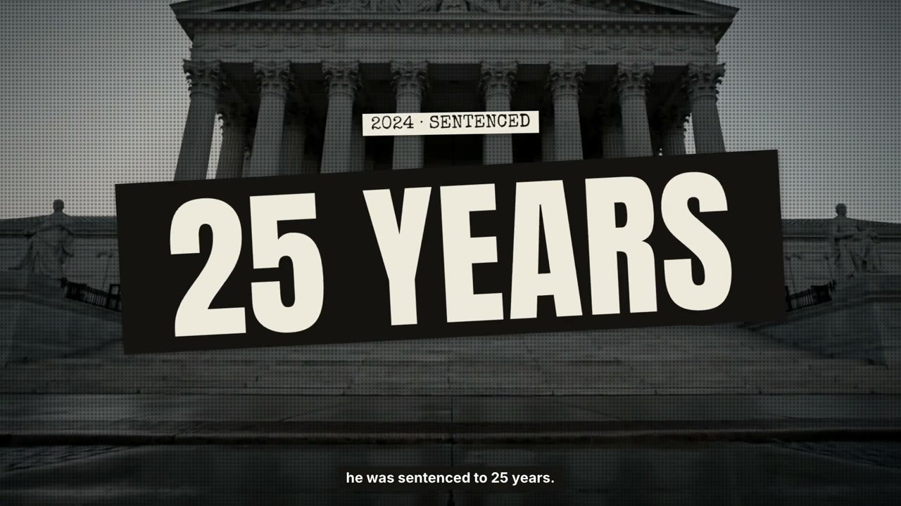

# styles

**What a film looks like, kept apart from how it is built.**

A film in [films/](../films/) is a recipe: what kind of film, how the story runs, how picture meets narration. A style
is a skin: palette, type, texture, light, materials, how characters stay the same, and the motion feel. Any recipe can
take any style that fits it, so "a launch film in low-poly" does not need a new film.

Shots are in [moves/](../moves/), the process in [workflows/](../workflows/).

## Styles

| Stills | Style | Fits | Worked example |
|---|---|---|---|
|  | [**paper-collage**](paper-collage/) Torn paper, halftone b-roll, stamps and typed labels that land on their words | explainer | [films/explainer/paper-collage](../films/explainer/paper-collage/) |

## Using a style

1. Pick the film from `films/` first, then a style whose `fits` includes its category and method.
2. For a one-off film, show the person three styles, one still each, and let them choose. For a series, choose once.
3. Read the style's `STYLE.md` and build the film's elements with it. Where the film's own `taste.json` `style`
   differs, the chosen style wins on look, the film wins on everything else.

## Making a style

From a reference video or account: [workflows/style/style-from-reference](../workflows/style/style-from-reference/WORKFLOW.md).
Format: [STYLE.md](STYLE.md).

## Licence

MIT. Stills: CC BY 4.0, except real photos and logos inside them, which belong to their owners.
